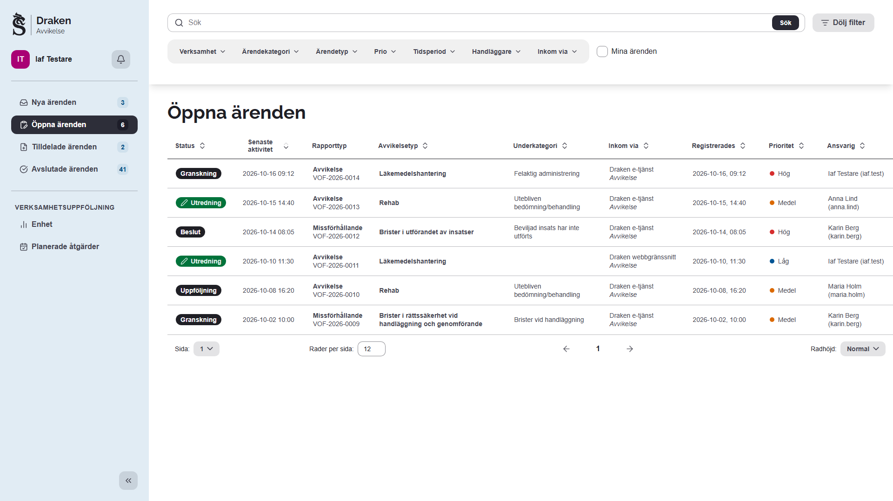
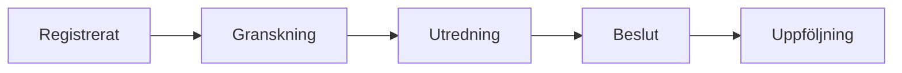
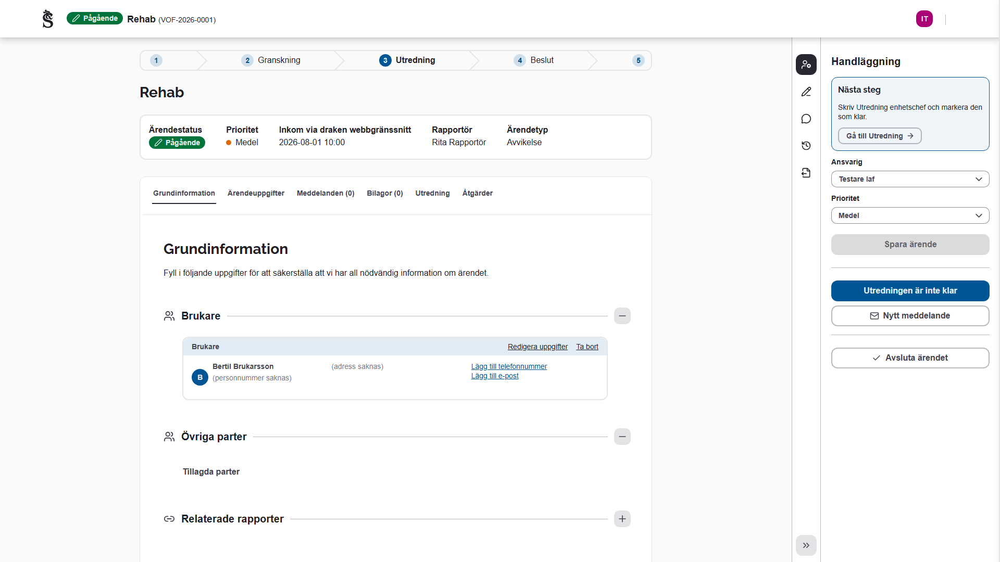
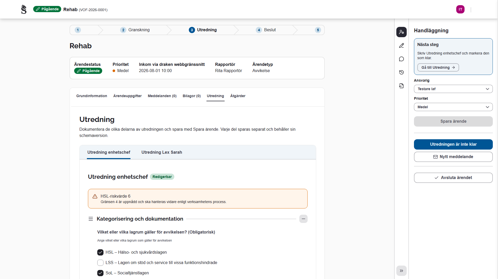
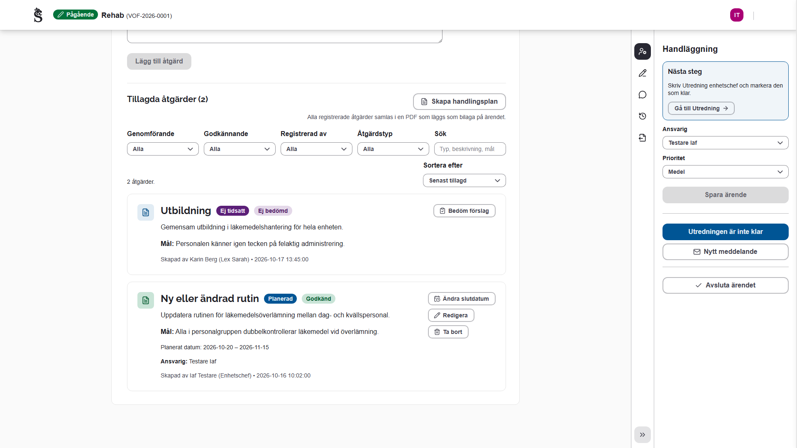
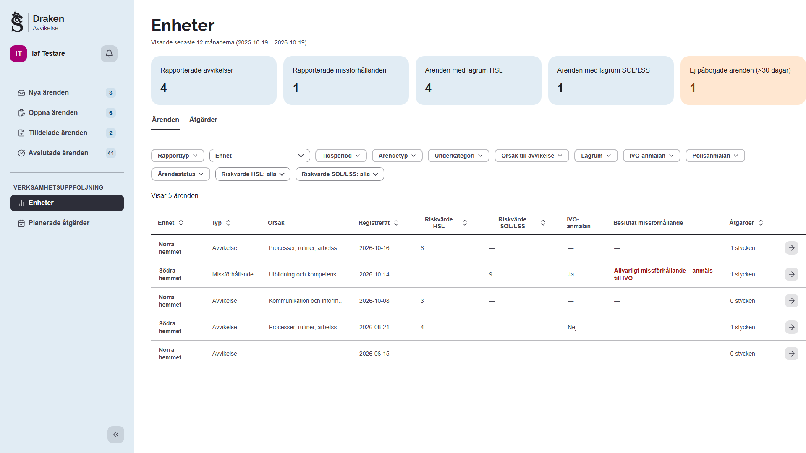
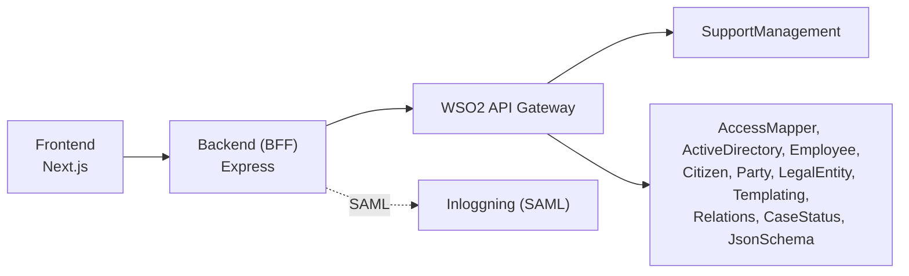

# Draken – avvikelsehantering

Sundsvalls kommuns system för avvikelsehantering inom vård och omsorg. Rapporter om avvikelser och
missförhållanden kommer in från e-tjänsten eller registreras direkt i Draken. De utreds av enhetschef, LEX och
MAS/MAR, beslutas och följs upp med åtgärder, och allt lagras i Support Management.

En och samma applikation körs i två driftsättningar, **IAF** och **VOF**. De fungerar likadant; det enda som
skiljer dem åt är backendens konfiguration: Support Management-namespacet (`SUPPORTMANAGEMENT_NAMESPACE`,
`HEALTHCAREDEVIATIONIAF` respektive `HEALTHCAREDEVIATIONVOF`) och AD-grupperna (`AUTHORIZED_GROUPS`, `ADMIN_GROUP`,
`DEVELOPER_GROUP`, `SUPERADMIN_GROUP`, `HEALTHCAREDEVIATION_HANDLER_ROLES`). Därutöver har varje driftsättning sina
egna adresser, portar, SAML-inställningar och hemligheter. Applikationen har inga feature-flaggor: allt
avvikelsehanteringen använder är alltid på.



## Innehåll

- [Rundtur](#rundtur)
- [Arkitektur](#arkitektur)
- [Kom igång](#kom-igång)
- [Konfiguration](#konfiguration)
- [Kodkvalitet och tester](#kodkvalitet-och-tester)
- [Fördjupning](#fördjupning)
- [Mer dokumentation](#mer-dokumentation)

## Rundtur

Skärmdumparna är tagna med påhittade ärenden och personer; se [Skärmdumparna](#skärmdumparna) för hur de tas om.

### Översikten

Översikten listar ärendena per statusgrupp: nya, öppna, tilldelade och avslutade. Varje rad visar rapporttyp,
avvikelsetyp och underkategori, var rapporten kom in, prioritet och ansvarig handläggare. Ovanför listan går det
att söka och filtrera på verksamhet, kategori, typ, prioritet, tidsperiod, handläggare och kanal, eller bara visa
de egna ärendena.

### Ärendet

Ett ärende följer arbetsflödets faser, som visas överst på ärendesidan, och avslutas när uppföljningen är gjord:



Sidopanelen till höger säger vad som är nästa steg för just den här handläggaren och erbjuder det som går att göra:
välja ansvarig, starta handläggningen, gå vidare till nästa fas, skicka meddelanden och avsluta ärendet.



### Utredning

Utredningen dokumenteras i formulär som byggs från JSON-scheman: enhetschefens utredning, Lex Sarah-utredningen
enligt SoL och LSS och HSL-utredningen. Varje del sparas för sig med sin egen schemaversion, och Support Management
avgör per användare och ärende vem som får läsa och skriva vilken del. Ett högt riskvärde markeras direkt i
formuläret.



### Åtgärder

Åtgärder registreras på ärendet: genomförda direkt, eller planerade med start- och slutdatum. En enhetschef
beslutar sina egna åtgärder direkt; andra roller lägger förslag som chefen godkänner, godkänner delvis eller avslår.
Enhetschefen och verksamhetschefen följer sedan upp de godkända åtgärderna och anger om de gav önskad effekt.
Åtgärderna kan samlas i en handlingsplan som läggs på ärendet som PDF.



### Verksamhetsuppföljning

Under Verksamhetsuppföljning i översiktens sidomeny följer chefer, LEX och MAS/MAR upp ärendena och åtgärderna på
de enheter de når: lägeskort för perioden, och tabeller som går att filtrera på bland annat rapporttyp, enhet,
lagrum, riskvärde, IVO-anmälan och polisanmälan. Planerade åtgärder har en egen vy bredvid.



### Roller

Vem som gör vad bestäms av handläggarrollerna i `HEALTHCAREDEVIATION_HANDLER_ROLES` (se [AD-grupper och
handläggarroller](#ad-grupper-och-handläggarroller)):

| Roll                               | Gör i Draken                                                                          |
| ---------------------------------- | ------------------------------------------------------------------------------------- |
| Enhetschef                         | Utreder avvikelser på sin enhet, beslutar åtgärder och följer upp dem                 |
| Verksamhetschef                    | Följer upp åtgärder och verksamheten på sina enheter                                  |
| LEX-ansvarig                       | Gör den initiala bedömningen av ett missförhållande, fördelar och skickar till beslut |
| LEX-utredare                       | Utreder missförhållanden enligt SoL och LSS                                           |
| MAS/MAR                            | Utreder och beslutar det som gäller HSL                                               |
| Administratör (`SUPERADMIN_GROUP`) | Har alla registreringsroller för åtgärder och sätter vilka platser cheferna har       |

## Arkitektur



- **Frontend** (`frontend/`): Next.js 16 (App Router), React 19, TypeScript, Tailwind och Sundsvalls
  designsystem `@sk-web-gui`. Formulär med react-hook-form och yup; utredningarna ritas med `@rjsf` från
  JSON-scheman.
- **Backend** (`backend/`): Node 20, Express och routing-controllers. Backenden är en BFF: den loggar in användaren
  med SAML, hämtar AD-grupper och roller och anropar kommunens API:er genom WSO2. Den har ingen egen databas.

### APIer som används

Dessa APIer används i projektet, applikationsanvändaren i WSO2 måste prenumerera på dessa.

| API                        | Version |
| -------------------------- | ------: |
| SupportManagement          |    15.2 |
| SupportManagement (sprint) |    17.1 |
| AccessMapper               |     2.2 |
| ActiveDirectory            |     2.0 |
| Citizen                    |     3.0 |
| Employee                   |     2.0 |
| Templating                 |     2.1 |
| LegalEntity                |     2.0 |
| Party                      |     2.1 |
| Relations                  |     1.1 |
| CaseStatus                 |     4.3 |
| JsonSchema                 |     1.0 |

## Kom igång

### Krav

- Node >= 20 LTS
- Yarn

### Steg för steg

1. Klona ner repot.

2. Installera dependencies för både `backend` och `frontend`:

   ```bash
   cd frontend
   yarn install

   cd ../backend
   yarn install
   ```

3. Skapa .env-filer.

   Frontend (kör från `frontend/`):

   ```bash
   cp .env.local-example .env.local
   ```

   Backend (kör från `backend/`):

   ```bash
   cp .env.example.local .env.development.local
   ```

   Exempelfilerna är skrivna för IAF. För VOF byts namespace, AD-grupper och `/iaf` mot `/vof` i adresserna.

4. Fyll i env-filerna. URLer, nycklar och cert behöver fyllas i korrekt.

   - `CLIENT_KEY` och `CLIENT_SECRET` måste fyllas i för att APIerna ska fungera, du måste ha en applikation från
     WSO2-portalen
   - `SAML_ENTRY_SSO` behöver pekas till en SAML IDP
   - `SAML_IDP_PUBLIC_CERT` ska stämma överens med IDPens cert
   - `SAML_PRIVATE_KEY` och `SAML_PUBLIC_KEY` behöver bara fyllas i korrekt om man kör mot en riktig IDP
   - `HEALTHCAREDEVIATION_HANDLER_ROLES` är obligatorisk, se [AD-grupper och
     handläggarroller](#ad-grupper-och-handläggarroller)
   - `MUNICIPALITY_ID` är obligatorisk och anger kommunen som alla anrop till API:erna gäller. Den finns bara i
     backendens env: frontend skickar ingen kommunkod, och BFF:en tar aldrig emot någon från klienten

5. Starta utvecklingsservrarna.

   Backend (kör från `backend/`):

   ```bash
   yarn dev
   ```

   Frontend (kör från `frontend/`):

   ```bash
   yarn dev
   ```

## Konfiguration

### AD-grupper och handläggarroller

Backendens `HEALTHCAREDEVIATION_HANDLER_ROLES` anger handläggarrollerna: en post per roll
med den AD-grupp som har den. Inställningen är obligatorisk, backend startar inte utan den. Samma lista fyller
handläggarlistan med rollgruppernas medlemmar, grupperad per roll, styr vilken roll överlämningsstegen kräver
och avgör vem som registrerar och följer upp åtgärder. Formatet beskrivs i
`frontend/src/supportmanagement/measures/README.md`. Medlemmar i `SUPERADMIN_GROUP` har alla
registreringsroller för åtgärder. `/me` anger vilka roller den inloggade har via sina grupper (`roleKeys`) och
om hen är med i `SUPERADMIN_GROUP` (`superadmin`).

Medlemmar i `SUPERADMIN_GROUP` sätter också vilka platser varje enhetschef och verksamhetschef har, under
Administration → Chefer per plats i översiktens sidomeny. Draken skriver bara platserna, som mönster på
personen i AccessMapper. Chefsrollen följer med en AD-grupp som beställs för sig. Se
`frontend/src/supportmanagement/investigation/avvikelse/README.md`.

Ett konto i flera rollgrupper visas en gång per roll men räknas som en handläggare. Handläggarlistan
cachas i backend i en timme; om något gruppanrop misslyckas
returneras ett fel i stället för en ofullständig lista. Starta om backendens
`yarn dev`-process efter en env-ändring och ladda om sidan.

Gruppnamnen anges separat per miljö. Välj de faktiska test- eller produktionsgrupperna i env;
koden ändrar inga suffix. Handläggarrollerna ger inga inloggnings- eller skrivrättigheter:
`AUTHORIZED_GROUPS` styr inloggning och `ADMIN_GROUP`, `SUPERADMIN_GROUP` samt
`DEVELOPER_GROUP` behåller sina befintliga applikationsroller. De tre tar en grupp eller en
kommaseparerad lista med grupper.

### Support Management: stable, sprint och sökindex

Utredningen kräver Support Managements sprintkontrakt, så backendmiljön väljer det uttryckligen:

```env
SUPPORTMANAGEMENT_API_TARGET=sprint
```

Tillåtna värden är `stable` och `sprint`. Ett okänt värde stoppar backend vid uppstart, så att en felstavad
deploymentinställning inte tyst byter API-kontrakt. Utredningsprofilen kräver `sprint`; en felaktig
stable-deployment annonserar därför utredningen och dess registrering som otillgängliga i stället för att
försöka använda ett inkompatibelt API.

Sprintkontraktet (`supportmanagement-sprint/17.0`) har ett sökindex för ärenden. Bara indexets count kan dela upp
antalet per status (`GET …/errands/search/count?groupBy=status`); filter-endpointens count (`…/errands/count`) svarar
med ett enda antal. Sidomenyns räknare frågar därför alltid indexet på sprintmålet, med ett anrop för alla
statusgrupper, medan stable-målet frågar filter-endpointen en gång per grupp.

Översiktens lista svarar från indexet först när deploymenten slår på det:

```env
SUPPORTMANAGEMENT_ERRAND_SEARCH=true
```

Slå på flaggan först när API-teamet har byggt om indexet för namespacet; ärenden som skapades innan sök infördes finns
annars inte i indexet. Tills dess räknar sidomenyn bara de ärenden som finns i indexet, så den kan visa färre än
listan. Flaggan kräver `SUPPORTMANAGEMENT_API_TARGET=sprint` och stoppar annars backend vid uppstart.
Söken matchar samma fält och på samma sätt (delsträng) som filtret gjorde. Filter-endpointen svarar fortfarande när
indexet inte kan svara likadant: när sökklustret är nere (503), när frågan blir längre än indexets 2000 tecken, när
en vald etikett saknas i metadatan och för Mina ärenden hos MAS/MAR, vars handläggarparameter indexet inte kan matcha. Ett sök som indexet ger upp efter tio sekunder (504) visas som ett fel.

Drakens ärende-, handläggar- och statuskommandon kräver en exakt stark `If-Match` och skickar samma
version vidare till Support Management. Den 2 september 2026 verifierades de publicerade OpenAPI-kontrakten för både
`supportmanagement/15.1` och `supportmanagement-sprint/15.1`: båda deklarerar `If-Match`, svaren 409/412 och
versionsfält på ärenden och JSON Parameters. Därmed använder stable- och sprintdeploymenterna samma atomiska
skrivkontrakt utan en svag kompatibilitetsväg i Draken. Kontrollera kontrakten på nytt när någon prenumeration byter
version; Drakens förkontroll av version och status ersätter inte atomisk versionskontroll i upstream.

Statuskommandot validerar klientens källstatus och version mot ett färskt ärende samt målstatusen mot live metadata.
Support Management 15.1 exponerar däremot ingen source→target-graf eller exekveringsroute för statusövergångar, så
Draken kan inte auktorisera själva kanten utan att införa appspecifika regler. Den domänregeln behöver ägas av
Support Management innan starkare generell transitionvalidering kan införas.

Läs- och skrivrättigheter för utredningsdokumentens JSON Parameter-nycklar konfigureras i Support Managements
AccessMapper för aktuellt namespace. Draken skickar den inloggades AD-identitet i `X-Sent-By` och låter Support
Management vara enda ägare till åtkomstbeslutet.

### Metadata från Support Management

BFF:en sparar namespacets metadata från Support Management – kategorier, etiketter, statusar, faser, roller och
åtgärdstyper – i en timme och delar den mellan alla anrop (`backend/src/services/support-metadata-cache.ts`). En
ändring i metadatan, till exempel en ny plats eller kategori, syns därför i Draken inom en timme, eller direkt efter
att backend har startats om.

### Testmiljöer

I testmiljöer där CaseStatus inte ser applikationens rapporter kan frontend visa exempelrapporter under
Relaterade rapporter med `NEXT_PUBLIC_USE_RELATED_REPORTS_MOCK=true`. Aldrig i produktion.

## Kodkvalitet och tester

### Kodkvalitet

Kör från repots rot:

```bash
yarn verify # Typkontroll, strikt lint, formatkontroll, Knip och backendtester
yarn knip   # Dödkod, oanvända exporter och oanvända dependencies
```

Utvecklingsrouten `src/app/**/page.dev.{ts,tsx}` deklareras som entry i Knip, eftersom Next konfigurerar dessa sidändelser endast i utvecklingsläge. Labbet och dess beroenden analyseras därför också.

Knip körs även vid `pre-push` och som en blockerande GitHub Actions-kontroll för pull requests samt push till `develop` och `main`.

Undantag i `backend/knip.json` och `frontend/knip.json`:

- `src/data-contracts/**` (samt `src/common/data-contracts/**` i frontend) — ägs av kodgeneratorn,
  inte av handskriven kod.
- `enumMembers` — enumvärden kan vara externa API-kontrakt även när varje medlem inte refereras lokalt.
- `backend/src/tests/helpers/mock-data.ts` — registret över testidentifierare (personnummer,
  organisationsnummer, telefonnummer) med dokumenterad proveniens. Värden ska ligga kvar även när
  inget test råkar använda dem just nu, så att nästa test importerar därifrån i stället för att
  hårdkoda ett nytt nummer.

Backend har dessutom taggen `@openapi`. En DTO-klass som bara existerar för att hamna i
OpenAPI-specen (och därmed i frontendens genererade `data-contracts`) har ingen importör i
backend, men får inte tas bort. Märk den i så fall så här:

```ts
/** @openapi */
export class MinResponseDto { ... }
```

Behöver klassen inte exporteras räcker det att ta bort `export` — schemat byggs av
class-validator-metadatan när modulen laddas, inte av exporten.

### Tester

**Backend** (Vitest, kör från `backend/`):

```bash
yarn test           # Kör enhetstesterna en gång
yarn test:watch     # Watch-läge
yarn test:coverage  # Med täckningsrapport (v8)
yarn type-check:test # Typkontroll av testerna
```

Testerna ligger i `backend/src/tests/` (`*.service.test.ts`).

**Frontend** (kör från `frontend/`):

```bash
yarn test                       # Enhetstester (Vitest)
yarn test:watch                 # Vitest i watch-läge
yarn test:coverage              # Med täckningsrapport (v8)
yarn type-check:test            # Typkontroll av testerna
yarn test:e2e                   # Playwright E2E (kräver att `yarn dev` körs)
yarn test:e2e:schema-lab        # Playwright E2E för utvecklingslabbet
yarn test:e2e:ui                # Playwright interaktivt
```

Enhetstesterna ligger bredvid modulen de testar (`<modul>.test.ts`) och körs med Vitest,
samma testkörare som backend. Assertions skrivs med `node:assert/strict` i stället för
`expect`, och `globals` är avstängt — allt importeras explicit. Alias som `@common/*` löses
upp av Vite direkt ur `tsconfig.json`, så även moduler med beroenden går att enhetstesta;
allt som kräver rendering hör fortfarande hemma i Playwright. Testerna omfattas inte av
`yarn type-check` utan av `yarn type-check:test` (se CLAUDE.md för varför).

### Skärmdumparna

Skärmdumparna i den här filen tas av ett eget Playwright-projekt, `readme`
(`frontend/e2e/readme/readme-screenshots.spec.ts`). Det mockar varje anrop, så bilderna visar bara påhittade
ärenden och personer, och de hamnar i `docs/screenshots/`. Ta om dem efter en ändring i gränssnittet:

```bash
yarn dev                  # i frontend/, i en terminal
yarn screenshots:readme   # i frontend/, i en annan
```

Med `NEXT_PUBLIC_ENVIRONMENT=TEST` visar applikationen utredningens felsökningspaneler och märker sig som TEST, så
starta dev-servern med ett annat värde, och gärna med `NEXT_PUBLIC_APPLICATION_NAME=Avvikelse`, när bilderna ska
in i README:n. Projektet ingår inte i CI.

### Övriga kommandon

| Kommando                      | Beskrivning                                               |
| ----------------------------- | --------------------------------------------------------- |
| `yarn build`                  | Bygger för produktion                                     |
| `yarn start`                  | Startar produktionsserver                                 |
| `yarn test:e2e`               | Kör Playwright E2E-tester                                 |
| `yarn screenshots:readme`     | Tar om skärmdumparna i README:n (frontend)                |
| `yarn generate:datacontracts` | Genererar TypeScript-typer från API:erna (backend)        |
| `yarn generate:contracts`     | Genererar TypeScript-typer från backendens API (frontend) |

## Fördjupning

### Behörigheter för utredningsdokument

Utrednings- och beslutsdokumentens rättigheter hämtas per användare och ärende från
Support Management Sprint 16.0, `GET /{municipalityId}/{namespace}/errands/{errandId}/access`.
Backend erbjuder projektionen som `GET /supporterrands/{errandId}/investigation-access`.
Den globala utredningsprofilen beskriver dokument och scheman; den innehåller inga behörigheter.

Draken tolkar endast den nycklade samlingen `jsonParameters` och resursen `errand/json-parameter`
i detta flöde. Explicit skrivrätt ger redigering, läsrätt ger ett skrivskyddat formulär och en
utelämnad nyckel döljer dokumentet. `allKeys` gäller även dokument som ännu inte skapats.
Ärendets nivå gäller ärendet själv, inte dokumenten: `jsonParameters` skrivs genom en egen endpoint,
så en nyckel - eller hela fältet med `allKeys` - och resursen `errand/json-parameter` får ge `RW` även
där ärendets nivå är `R` eller `LR`. Ett dokument kan redigeras när både nyckeln och resursen ger `RW`.
Ärendets egna fält (`PATCH` av ärendet) följer fortfarande ärendets nivå.
Access hämtas när ärendet öppnas, dess version eller etiketter ändras, fönstret återfår fokus,
anslutningen återkommer och efter nekade dokumentanrop. Backend kontrollerar på nytt vid varje
dokumentläsning och skrivning. Felaktiga eller otillgängliga svar ger ingen åtkomst.

Dokumentutkast behålls i komponenternas minne när access kontrolleras eller nekas. Innehållet
döljs tills en läsrätt har verifierats för ärendet och användaren. Vid en omkontroll av samma ärende visas det
föregående svaret tills det nya kommit, så att en sparning inte tömmer sidan. Omkontroll kan göras utan omladdning. Varningen
för osparade ändringar gäller även dolda utkast. Utkast sparas inte över omladdning och följer
inte med till en annan användare eller ett annat ärende.

`SUPPORT_INVESTIGATION_DOCUMENT_GROUPS` används inte längre. AD-grupper, roller och dokumentgrants
administreras i AccessMapper och Support Management. Utredningen kräver sprint-API:t även för access;
en deployment utan detta kontrakt ska inte falla tillbaka till env-baserade skrivrättigheter.
Kategoriseringen skriver vanliga ärendefält och behåller `canEditSupportManagement` utöver
skrivrätten till ägardokumentet. Dokumentredigerare utan kategoriseringsrätt får ändra dokumentet
när den befintliga kategoriseringen är giltig. Ändringar av lagrum som skulle kräva omklassificering
stoppas direkt med en förklaring; saknad eller ogiltig kategorisering förklaras innan redigering.
Övriga applikationsrättigheter och handläggarlistor migreras separat.

### Tjänsteanteckningar i supportärenden

Sidopanelen visar **Tjänsteanteckningar** före **Kommentarer**. Support Management har ingen typ på
anteckningar, så typen ligger i anteckningens `context`: kommentarer skrivs som tidigare med
`context: SUPPORT` och `role: FIRST_LINE_SUPPORT`, tjänsteanteckningar med `context: SERVICE_NOTE`
och `role: ERRAND_HANDLER`. Varje lista hämtar bara sin egen typ.

Bara ärendets handläggare (`assignedUserId`) skriver en tjänsteanteckning, och bara
medan ärendet tar emot ändringar. En sparad tjänsteanteckning kan inte ändras eller tas bort genom
Draken. AccessMapper ger behörighet till anteckningar som en resurs och kan inte skilja typerna åt,
så reglerna ligger i backenden (`support-note.service.ts`). Texten får vara högst 2048 tecken, vilket
är Support Managements gräns.

### Notiser i supportärenden

Notiserna kommer från Support Managements prenumerationsmodell.

- **Vem får notiser.** Bara ärendets handläggare följer ärendet (profilens `assigneeFollowsErrand`). Support
  Management prenumererar själv den som är tilldelad. Den som tilldelar eller lämnar över ärendet till någon
  annan slutar följa det, så BFF:en tar bort hens prenumerationer på ärendet. Därför finns ingen Följ ärendet i
  sidopanelen.
- **En notis per ärende och utskick.** Support Management skickar ut notiser var femte minut och gör då en
  notis per ärende och användare av det som hänt sedan förra utskicket (`GET /supportnotifications`). Ett
  ärende kan alltså ha flera notiser. En handling tas med först när den har varit tyst i tio sekunder, så
  notisen kommer mellan tio sekunder och drygt fem minuter efter händelsen. Notisens händelser bär tiden
  för utskicket, inte för händelsen. Klockan hämtar listan en gång i minuten, pausar i en dold flik och
  hämtar direkt när användaren byter vy.
- **Notiserna i ärendeloggen.** Ärendeloggen markerar de händelser användaren har fått notis om, och en
  länk från en notis lyfter fram händelsen den gäller. Support Management talar inte om vilken
  logghändelse en notishändelse gäller, så de paras ihop: samma undertyp, logghändelsens text lika med
  notishändelsens beskrivning och logghändelsen högst sex minuter före notishändelsen
  (`matchEventToNotification`).
- **Kvittens.** Ett ärendes notiser kvitteras när ärendet öppnas, hur användaren än kommer dit
  (`PUT /supportnotifications/:errandId/acknowledge-all`). I panelen går det också att
  markera notiser som lästa. En kvitterad notis ligger kvar tills Support Management låter den gå ut.
  **Senaste aktivitet** i översikten visar den senaste händelse användaren inte har kvitterat, och
  annars när ärendet senast ändrades.
- **En handling blir en notis.** Alla anrop under en användarhandling bär samma `X-Request-Group-Id`,
  så Support Management gör en notis av dem. Frontend sätter id:t med `withRequestGroup`, och
  följdskrivningarna hör till samma handling: statusen efter en tilldelning, självtilldelningen innan
  ett ärende stängs, faserna vid Starta handläggning och statusen efter en kompletteringsbegäran. BFF:en skickar id:t vidare till Support Management, eller ger requesten ett
  eget id om webbläsaren inte skickade något (`utils/request-group.ts`).
- **Tysta skrivningar.** Det systemet skriver på egen hand notifierar ingen. Det gäller läsmarkeringar,
  kvittenser, prenumeranten som skapas vid första besöket, rapportens bokföring runt bilagan, faserna
  ett ärende passerar när det stängs från en tidigare fas. Avvikelsens labels `RISK/HIGH_HSL`, `ANALYSIS/HSL_STARTED` och
  `ANALYSIS/VC_COMMENT_HSL` är aldrig tysta, eftersom prenumerationsprofilerna aviserar från dem. BFF:en skickar då
  `X-notify: false` (`notifySubscribers: false` i `ApiService`). Support Management läser headern från
  17.0 (`SUPPORTMANAGEMENT_API_TARGET=sprint`); äldre versioner ignorerar den. Ändringar användaren själv gör ska aldrig vara tysta.
- **E-post och SMS väljer användaren själv.** Användarmenyn har valet **Notiser**, där
  användaren kryssar i om notiserna också ska komma med e-post eller SMS. Valet lagras som kanaler på
  användarens prenumerant i Support Management (`GET`/`PATCH /supportsubscribers/me`),
  och dialogen visar det som ligger där; Draken har inget eget förval.
  - Notiserna i Draken går inte att välja bort: BFF:en lägger alltid till kanalen `INTERNAL`.
  - BFF:en tar bara emot kanalens typ. En egen adress eller ett eget nummer (`destination`) avvisas, så
    e-post och SMS går till det som hör till kontot.
  - Menyvalet kommer ur utredningsvariantens slot `notificationChannels`.
  - **Rollprofilerna går före.** En prenumeration som pekar på en prenumerationsprofil (rollnotiserna)
    levereras på profilens kanaler så länge profilen har några. Användarens eget val gäller då
    bara övriga prenumerationer, till exempel ärenden hen följer. Först när en profil saknar kanaler
    levereras dess händelser på användarens egna.

## Mer dokumentation

- [`docs/kvar-infor-prodsattning.md`](docs/kvar-infor-prodsattning.md) – det som återstår innan applikationen
  driftsätts i produktion
- [`CLAUDE.md`](CLAUDE.md) – arkitekturen, reglerna som håller IAF och VOF till en applikation och hur ett ärende
  skrivs till Support Management
- [`frontend/src/supportmanagement/investigation/avvikelse/README.md`](frontend/src/supportmanagement/investigation/avvikelse/README.md)
  – utredningen, tilldelningsflödet, nästa steg, verksamhetsuppföljningen och chefer per plats
- [`frontend/src/supportmanagement/measures/README.md`](frontend/src/supportmanagement/measures/README.md) –
  åtgärderna, registreringsrollerna och uppföljningen
